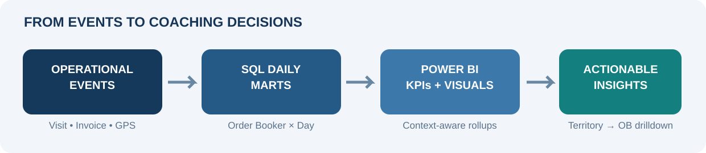

# ICE Tracker · Field Force Effectiveness Intelligence

**A decision-ready FMCG field-execution analytics case study built with SQL Server, Power BI and DAX.**  
*From delivery totals to the everyday reasons behind execution gaps.*

    

> **Executive takeaway:** Sales outcomes alone don't tell a distribution manager *why* a field day failed. The tracker connects route coverage, outlet conversion, time utilization, location credibility and basket depth to the same daily order-booker view.

## What this solution answers

| Leadership question | Diagnostic lens | Action enabled |
|---|---|---|
| Did the team book and deliver effectively? | App/web, booked/delivered, execution %, 80/20 outlet mix | Investigate booking vs fulfillment gaps |
| Did field staff work the right route? | PJP shops, planned/unplanned visits, missed shops, strike rate | Prioritize missed planned outlets |
| Was time in the market productive? | Sync-down/up, trade/field/shop time, idle time, calls per hour | Coach time allocation and daily discipline |
| Can outlet activity be trusted? | Captured GPS, outlet reference GPS, 100-metre validity | Audit data quality before enforcing compliance |
| Are orders sufficiently diverse? | Brand, segment and SKU depth; 1/2/3+ piece bands | Spot low-depth selling and cross-sell opportunities |

## Explore the case study

| Section | What you'll find |
|---|---|
| **[Business case and analytical decisions](docs/CASE_STUDY.md)** | Stakeholders, pain points, why existing sales-only reporting was insufficient, solution logic and decision outcomes |
| **[Report page & visual guide](docs/VISUAL_WALKTHROUGH.md)** | All **10 observed pages**: rules + overview + 4 analytical chart pages + 4 detail matrices; field-to-visual examples verified against PBIX metadata |
| **[KPI business rules](docs/KPI_DICTIONARY.md)** | Definitions, grain, calculation bases, percentage and median subtotal rules, GPS and Pareto methodology |
| **[DAX semantics & audit status](docs/DAX_EXPLAINED.md)** | Verified existing DAX versus illustrative patterns; measures shown in visual bindings, with explicit provenance |
| **[Architecture & lineage](docs/ARCHITECTURE.md)** | Source systems → SQL analytical queries → Power BI model → managerial decisions |
| **[Data quality and known issues](docs/DATA_QUALITY.md)** | Inclusive date pitfalls, 100m denominator/visit-grain ambiguity, Pareto, threshold and weighted-score gaps |
| **[Exact SQL source extracts](sql/)** | Six supplied SQL query drafts, kept source-faithful for review |
| **[Legacy Market Time workstream](market-time-tracker/)** | Pre-existing DAX measures and focused documentation; retained rather than discarded |

## Scope observed in supplied report

**10 Power BI pages**: KPI Business Rules, Overview, Daily Sales charts, Route Execution charts, Market Time & GPS charts, Product Mix charts, and four detailed tabular views.

The business-rules header **displays 68 KPIs** split into Daily Sales **16**, Route **15**, Market Time & GPS **18**, Product Mix **19**. **This is the displayed definition count, not 68 independently validated DAX formulas.** The exported rules screenshot visibly clips some lower entries; see [evidence limits](docs/SOURCE_AND_LIMITATIONS.md).

The data is primarily modeled at **Order Booker × reporting day**, with event- and invoice-level staging logic in SQL. Regional and managerial drilldowns use a separate organizational hierarchy. One **score of the day / 35–30–20–15 weighted index is *not* represented as implemented**: source SQL explicitly flags its calculation as pending formal weight criteria.

## Source SQL workstreams

| Query | Analytical purpose |
|---|---|
| [Daily Sales](sql/01-daily-sales-performance.sql) | Invoice net amount, booking versus delivery, App vs Web, planned vs unplanned, outlet Pareto |
| [Route Execution](sql/02-route-execution-productivity.sql) | PJP baseline, productive/nonproductive visits, planned execution, missed value, visit GPS check |
| [Market Time & GPS](sql/03-market-time-gps.sql) | Sequenced visits, duration windows, idle gaps after 5-minute allowance, consecutive-stop distance, GPS |
| [Product Mix](sql/04-product-mix.sql) | Distinct brands/segments/products per invoice, cross-brand invoices, per-invoice brand piece buckets |
| [Piece-band chart source](sql/05-brand-piece-bands.sql) | Brand × piece-band tall/normalized chart dataset |
| [Organizational Hierarchy](sql/06-organizational-hierarchy.sql) | Zone → region → area → territory → town / locality and GSM–RSM–ASM–TM–OB ownership |

## A note on evidence, privacy and portability

This is a **portfolio-level architectural and analytical documentation repo**, not a published live production database. The provided PBIX and PDF contain organization-specific details, real names and operational results. For that reason, the full model, raw original PDF and actual operational rows are **not committed to the public repo**. The [screenshot preparation note](assets/README.md) explains public-safe visual assets. The SQL is supplied as a **reviewable source draft**, not certified to run in another environment. There are no invented return-on-investment or productivity uplift claims.

Original DAX expressions inside the uploaded PBIX DataModel were **not extractable in this environment because the model is XPress9 compressed**. This repo accurately labels **existing verified versioned DAX**, **PBIX visual bindings**, and **reconstruction examples** separately. For exact model expressions, export the PBIX to **PBIP/TMDL** in Power BI Desktop and reconcile measure names; see the [provenance guide](docs/SOURCE_AND_LIMITATIONS.md).

---

### Hiring-manager 30-second read

**Problem →** Managers knew how much was sold, but could not consistently explain missed visits, low strike rates, idle intervals, inaccurate GPS or narrow product baskets.  
**Design →** SQL event consolidation and invoice-aware aggregation, reporting-day grain, hierarchy-aware Power BI pages, carefully chosen DAX subtotal semantics.  
**Outcome enabled →** Earlier identification and drilldown of the behavior behind field results. *Measured uplift is not claimed because no before/after outcome data was supplied.*

**Start with the [full case study](docs/CASE_STUDY.md).**
