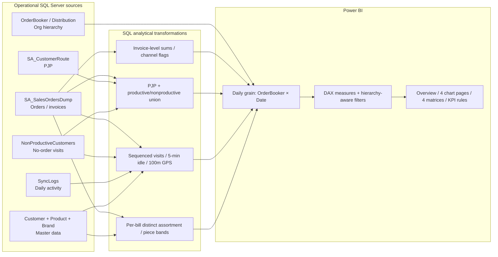

# Architecture & lineage

## Fact granularity and correctness

- **Transaction level:** `SA_SalesOrdersDump` may contain one row per product on an invoice. A bill is the stable `InvoiceCode` unit, not the physical row.
- **Visit level:** Productive visits use App order timestamps; nonproductive visits use `CreatedOn` and supply no separate visit end time.
- **Reporting level:** Most source SQL outputs collapse to **Order Booker + Date**. The hierarchy query supplies mapping and management attributes.
- **Visual level:** Managers slice by time, region, area, territory, town, distributor, OB, RSM/ASM/TSO/GSM where available.

## Source → metric → visual examples

| Source fields | Transformation | Measure/business object | Example visual |
|---|---|---|---|
| InvoiceCode, NetAmount, Status, Synchronized | Sum invoice lines + status/channel split | Sales Booked (App), Order vs Execution % | Overview combo trend; Daily Sales cards/matrix |
| Customer route + invoice + nonproductive | Union actual visits, compare PJP | PJP Compliance %, Strike Rate % | Route matrix, overview regional chart |
| SyncDown/SyncUp + OrderStart/Complete | Time windows, idle-over-5m gaps | Field Time, Trade Time, Longest Idle | Market cards, time trends and matrix |
| Captured coordinates + outlet coordinates | Meter distance with threshold | GPS Compliance %, % No GPS | Market GPS breakdown funnel |
| BrandID/SegmentID/ProductID by invoice | Distinct counts per bill | Avg Brands / Segments / Variants per Bill | Mix cards, matrix and decomposition |
| Per-invoice brand quantities | Bucket into 1 / 2 / 3+ pieces | 3+ Piece Rate | Brand piece-band bar/column |

**SQL artifacts are kept source-faithful.** They are examples of the transformation intent, not a deployable ETL framework. Consult [DATA_QUALITY.md](DATA_QUALITY.md) for source ambiguities and unresolved validation checks.
