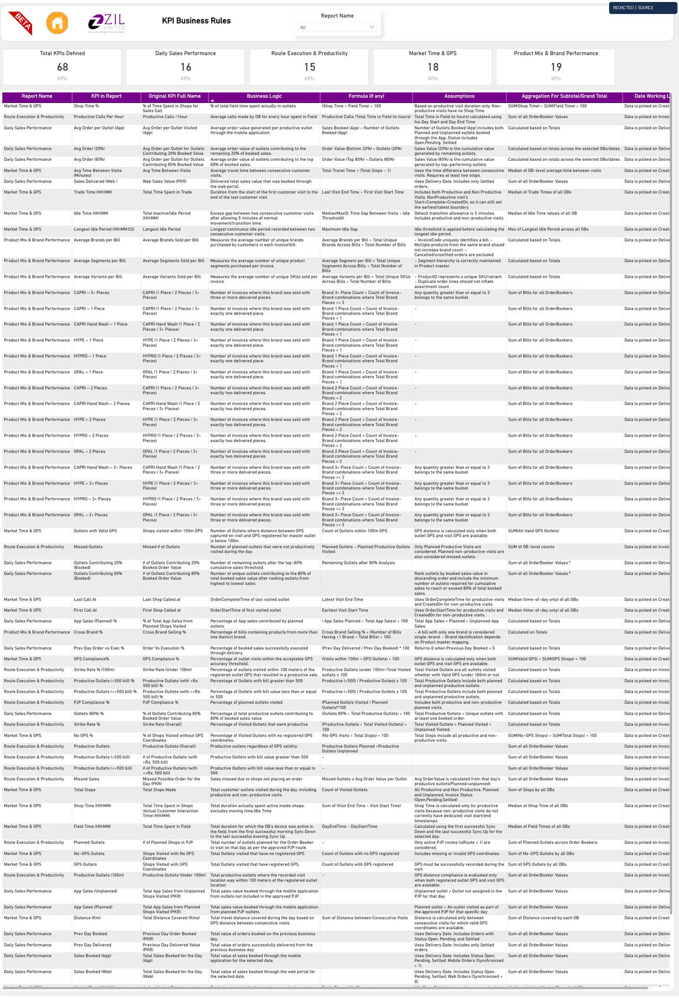
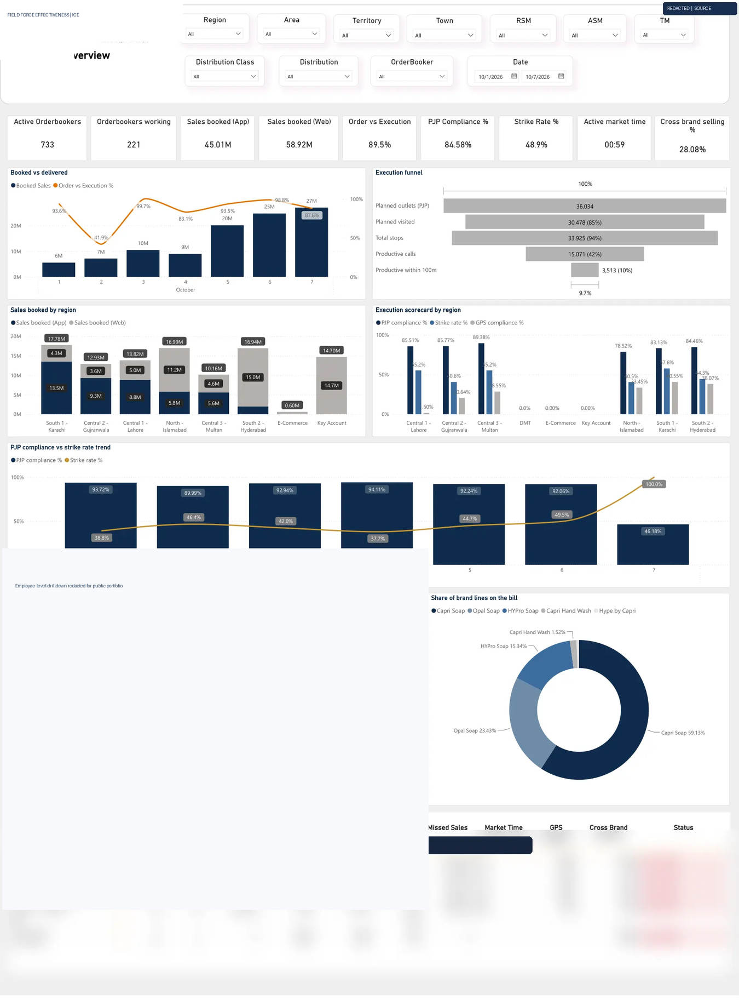
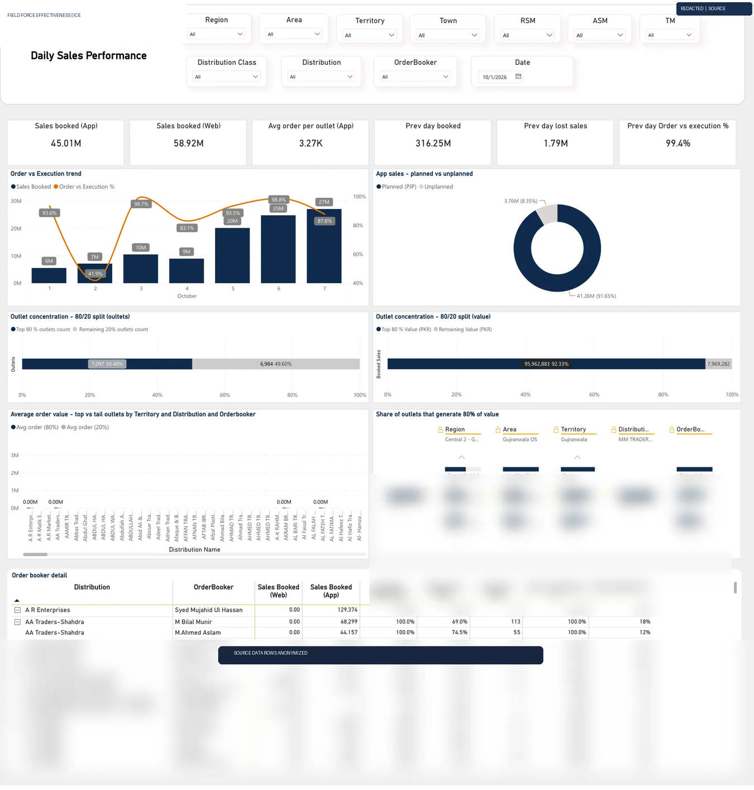
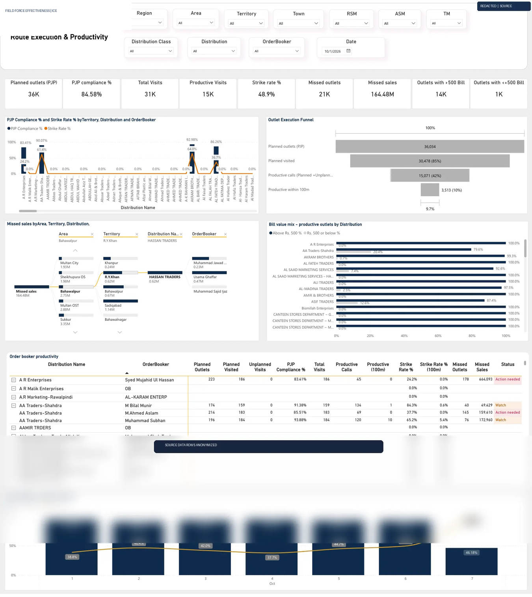
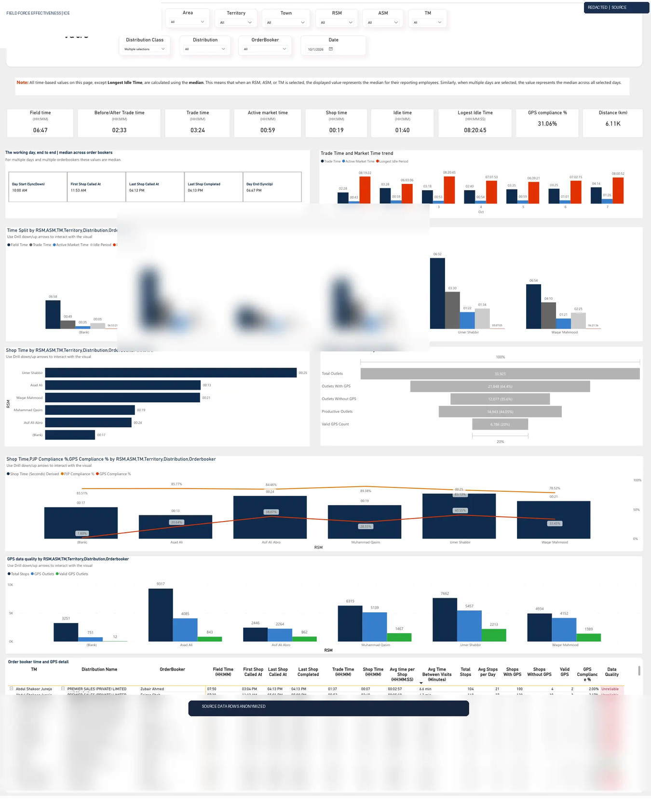
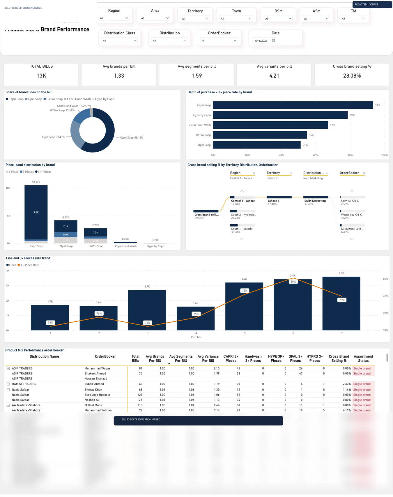
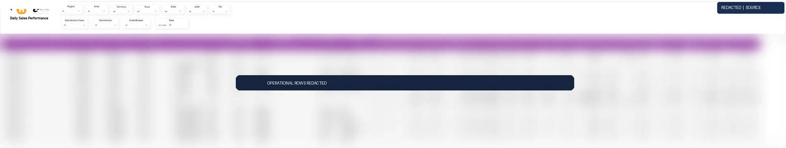
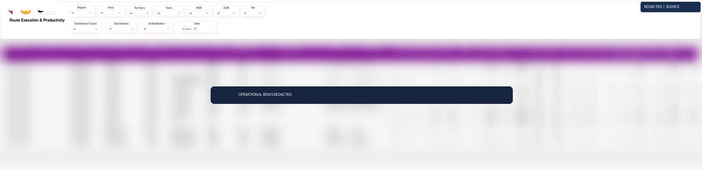
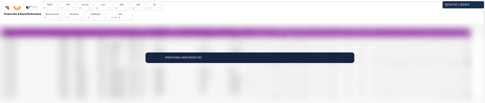

# ICE Tracker — Field Force Effectiveness Case Study

**Source:** ICE Tracker PDF (10 pages), PBIX visual bindings, and six provided SQL queries.  **Privacy:** Rendered dashboard images are redacted; even chart values may be commercial and should be reviewed before publishing.

## Executive context
Sales achieved does not explain whether planned routes were visited, whether time in-market generated real customer conversations, whether GPS captures were reliable, or whether each bill included diverse brands. A daily OrderBooker-by-date scorecard closes that diagnostic gap by separating sales results from visit execution, field hours, and basket depth.

## The dashboard as evidence
These are actual renders of the supplied PDF, with sensitive row content anonymized. They are **not recreated lookalikes**.

### 1. KPI Business Rules

Rules page: source PDF reports 68 KPIs across four domains (16, 15, 18, 19); visible rows are clipped.

### 2. Executive Overview

Cross-domain executive investigation starts at region/distributor level, then moves down to individual OrderBooker activity.

### 3. Daily Sales Performance - Charts

Book vs delivered, App vs Web, sales execution and outlet Pareto indicators answer why revenue alone is not sufficient.

### 4. Route Execution & Productivity - Charts

Compare PJP planned shops, actual productive/nonproductive calls, strike rate, visit count and low-value orders.

### 5. Market Time & GPS - Charts

Shop time, trade time, 5-minute idle allowance and captured/reference GPS thresholds measure execution quality.

### 6. Product Mix & Brand Performance - Charts

Distinct brands, segments, variants per invoice and per-brand 1/2/3+ piece bands show mix quality.

### 7. Daily Sales Performance - Detail Matrix

Matrix provides granular cross-check by organizational hierarchy. Business values and named rows are redacted in portfolio media.

### 8. Route Execution & Productivity - Detail Matrix

Matrix provides granular cross-check by organizational hierarchy. Business values and named rows are redacted in portfolio media.

### 9. Market Time & GPS - Detail Matrix

Matrix provides granular cross-check by organizational hierarchy. Business values and named rows are redacted in portfolio media.

### 10. Product Mix & Brand Performance - Detail Matrix

Matrix provides granular cross-check by organizational hierarchy. Business values and named rows are redacted in portfolio media.

## Technical construction
- Six source SQL drafts: Daily Sales; Route Execution; Market Time & GPS; Product Mix; Brand Piece Bands; Organizational Hierarchy.
- Invoice header grain uses `SUM(NetAmount)` across invoice lines, preventing erroneous product-line duplication.
- Distinct outlets, invoices, and repeat visit events must not be conflated.
- Ratio subtotal is `SUM(numerator)/SUM(denominator)`, median is appropriate for selected time metrics, and max is appropriate for longest idle; exact definition must come from KPI rules.
- Verified PBIX report JSON contains page/visual/measure *references* but not source DAX expressions.

## DAX extraction status
**Exact DAX expressions NOT extracted.** The uploaded PBIX contains a proprietary XPress9-compressed DataModel. A parser required to decode the semantic model was unavailable in this runtime. Do not represent illustrative equations as extracted.

To complete precise formula extraction: in Power BI Desktop open the PBIX → File → Save As → Power BI Project (.pbip) using TMDL semantic model → review `definition/tables/*.tmdl` for measure expressions. Never upload credentials, production connection strings or personal data.

## Source binding inventory
See `reference/visual-measure-index.csv` and `reference/pbix-visual-bindings.json` for visual bindings extracted from the PBIX. Refer to `reference/source-kpi-extract.csv` for the visible KPI source definitions.

## Correctness checks before production
- Fix inclusive end dates on DATETIME columns using half-open filters.
- Validate GPS: visit-event denominator differs from distinct-customer denominator.
- Check Pareto threshold crossing and customer ties.
- Weighted daily score calculation is not approved in the supplied sources.
- Confirm that 100m accuracy and percentage of missing GPS answer different questions.

## Results
Enables regional performance coaching and OB-day diagnostic drilldown. **No business impact uplift is claimed** because validated before/after data has not been provided.

## Complete report-page evidence

### KPI Business Rules

**Why this matters:** definitions, formulas and rollup assumptions. The screenshot is sourced from the original report; private details may be redacted. [Original DAX measures and exact visual assignments](MEASURE_VISUAL_MAPPING.md).

### Executive Overview

**Why this matters:** performance signal and execution funnel. The screenshot is sourced from the original report; private details may be redacted. [Original DAX measures and exact visual assignments](MEASURE_VISUAL_MAPPING.md).

### Daily Sales Performance — Charts

**Why this matters:** booked/delivered, Pareto, execution. The screenshot is sourced from the original report; private details may be redacted. [Original DAX measures and exact visual assignments](MEASURE_VISUAL_MAPPING.md).

### Route Execution & Productivity — Charts

**Why this matters:** PJP, productive calls, missed opportunity. The screenshot is sourced from the original report; private details may be redacted. [Original DAX measures and exact visual assignments](MEASURE_VISUAL_MAPPING.md).

### Market Time & GPS — Charts

**Why this matters:** field/trade time, GPS validity, inactive gaps. The screenshot is sourced from the original report; private details may be redacted. [Original DAX measures and exact visual assignments](MEASURE_VISUAL_MAPPING.md).

### Product Mix & Brand Performance — Charts

**Why this matters:** brands per bill, piece bands, cross selling. The screenshot is sourced from the original report; private details may be redacted. [Original DAX measures and exact visual assignments](MEASURE_VISUAL_MAPPING.md).

### Daily Sales Performance — Detail

**Why this matters:** auditable breakdown at reporting hierarchy. The screenshot is sourced from the original report; private details may be redacted. [Original DAX measures and exact visual assignments](MEASURE_VISUAL_MAPPING.md).

### Route Execution & Productivity — Detail

**Why this matters:** route / planned vs actual table. The screenshot is sourced from the original report; private details may be redacted. [Original DAX measures and exact visual assignments](MEASURE_VISUAL_MAPPING.md).

### Market Time & GPS — Detail

**Why this matters:** median time and GPS matrix. The screenshot is sourced from the original report; private details may be redacted. [Original DAX measures and exact visual assignments](MEASURE_VISUAL_MAPPING.md).

### Product Mix & Brand Performance — Detail

**Why this matters:** product assortment table. The screenshot is sourced from the original report; private details may be redacted. [Original DAX measures and exact visual assignments](MEASURE_VISUAL_MAPPING.md).

## Semantic layer: exact measure evidence

The source TMDL export contains **90 original DAX measures**, now committed as exact source under [`dax/original-tmdl-export.txt`](../dax/original-tmdl-export.txt). Key business illustrations are backed by source-exact expressions, not placeholders. Their static report-page and chart mappings are in [the measure-to-visual catalog](MEASURE_VISUAL_MAPPING.md) and interpreted in [DAX explained](DAX_EXPLAINED.md). Revenue improvements and model computation correctness are not claimed without measured/test data.