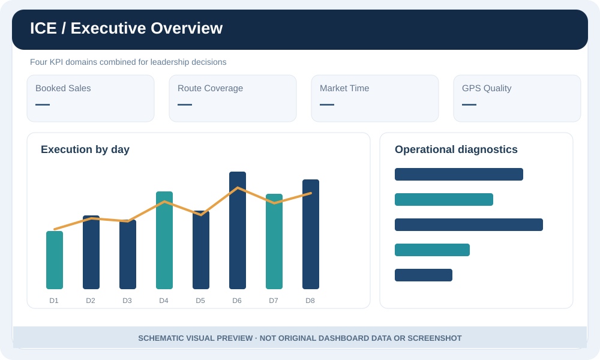
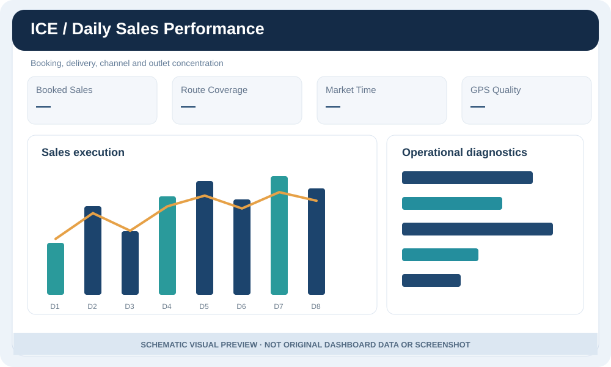
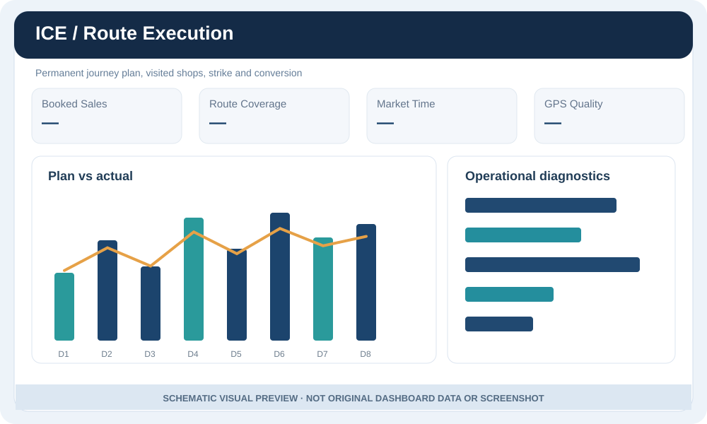

# Report gallery — visual storytelling

> **These five SVGs are new schematic illustrations of the report layouts. They are not screenshots, and contain no original performance data.** The supplied PDF was inspected and has **10 actual pages**. Redacted original captures were prepared separately as a local binary package; they were not pushed into this public repository.

## Executive overview

**Decision:** Identify the region or distribution where outcomes, route execution and compliance diverge.

## Daily Sales Performance

**Visual metrics:** Booked and delivered sales, execution %, App/Web, top-80% value outlet concentration, operational gap.

## Route Execution & Productivity

**Visual metrics:** Planned shops, route compliance, productive and nonproductive outlet counts, productive calls/hour, GPS-verified productive visits.

## Market Time & GPS

**Visual metrics:** Day start/end, field/trade/active/shop times, idle gaps (5-minute normal-transition allowance), 100m location compliance and GPS availability.

## Product Mix & Brand Performance

**Visual metrics:** Brands per bill, segments per bill, variants per bill, cross-brand share and brand-level 1 / 2 / 3+ piece bands.

## Original report-page inventory

The **real report** also has one KPI Business Rules page and four full-width detail-matrix pages. Refer to the [10-page observed report mapping](VISUAL_WALKTHROUGH.md) and the [KPI source guide](KPI_DICTIONARY.md). The schematic diagrams above do not imply exact numerical values or original layout pixel fidelity.
